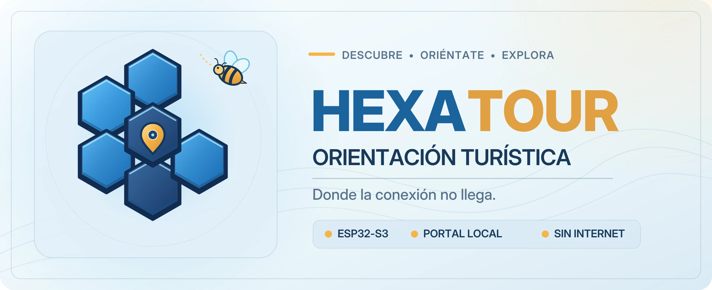

<div align="center">

<picture>
  <source media="(prefers-color-scheme: dark)" srcset="branding/hexatour-banner-oscuro.webp" />
  
</picture>

# HexaTour

**Orientación turística donde la conexión no llega.**

[](#sobre-el-proyecto) [](#usar-o-descargar) [](LICENSING.md)

[](#tecnologías) [](#tecnologías) [](#tecnologías) [](#tecnologías)

[Abrir aplicación](https://nicocg32.github.io/HexaTour/) · [Documentación](docs/README.md) · [Arquitectura](docs/01-arquitectura-general.md) · [Inicio rápido](#ejecutar-desde-el-código)

</div>

---

## Sobre el proyecto

Prototipo de orientación turística rural sin Internet: un portal cautivo en ESP32-S3 muestra puntos de interés y un Arduino UNO controla la impresión de indicaciones. Incluye una demo web para explorar sin hardware.

**Estado:** Prototipo de curso cerrado. La demo utiliza datos de ejemplo e impresión simulada; no ofrece PDF ni envío de urgencias. No hay instaladores publicados en GitHub Releases.

## Tecnologías

| Área                    | Tecnologías y responsabilidad                                              |
| ----------------------- | -------------------------------------------------------------------------- |
| **Hardware y firmware** | ESP32-S3 y Arduino UNO; C++/Arduino, SD y enlace serial.                   |
| **Portal**              | HTML, CSS y JavaScript; catálogo y fichas JSON en la SD.                   |
| **Herramientas**        | Python 3 para backend simulado, validación y preparación de demo estática. |

> **Enfoque técnico:** Portal local y control de impresora separados; demo web con simulación explícita.

## Usar o descargar

[Abrir la demo](https://nicocg32.github.io/HexaTour/) · [Recorrido y límites](docs/Demo.md) · [Montaje y compilación](firmware/Compilacion.md).

## Ejecutar desde el código

Para probar el portal con un backend simulado, usa Python 3.10+ desde la raíz:

```sh
python tools/backend-local/server.py --root web/www --port 8000
```

Abre [visitante](http://localhost:8000/visitor/) u [operador](http://localhost:8000/main/). La impresión física y el portal cautivo requieren el montaje. [Guía del simulador](tools/backend-local/README.md).

## Documentación

[Índice completo y rutas de lectura](docs/README.md) · [Manual del proveedor](docs/manual-proveedor.md).

| Tipo                | Lectura                                                                                                                                                                          |
| ------------------- | -------------------------------------------------------------------------------------------------------------------------------------------------------------------------------- |
| General             | [Problema, cliente y solución](docs/00-problematica-cliente-y-valor.md) · [Motivación](docs/16-motivacion-y-contexto.md)                                                         |
| Técnica             | [Arquitectura y diagramas](docs/01-arquitectura-general.md) · [Dominio y datos](docs/04-base-de-datos.md)                                                                        |
| Desarrollo          | [Etapas y metodología](docs/17-desarrollo-y-metodologia.md) · [Proyección](docs/15-escalabilidad-y-nuevos-mercados.md) · [Costos CLP/USD](docs/18-analisis-economico-clp-usd.md) |
| Académica/formativa | [Contexto e informes originales](docs/academica/README.md)                                                                                                                       |

[Identidad visual](branding/README.md): logos, banners y variantes de aplicación.

## Licencia y créditos

Código propio bajo [MIT](LICENSE). [Créditos, terceros y condiciones de reutilización](LICENSING.md).
