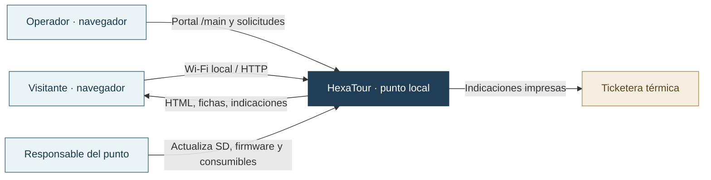
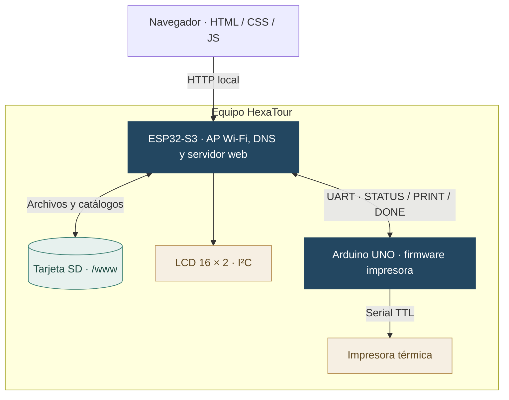
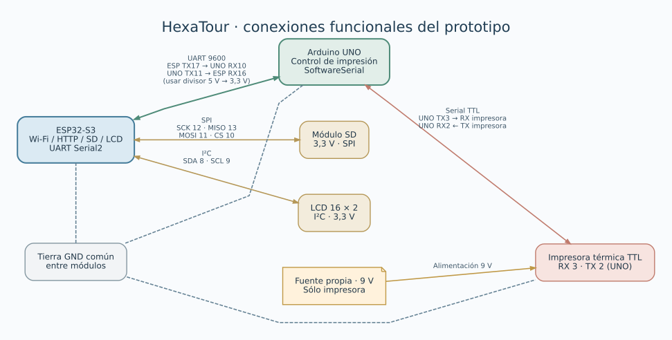
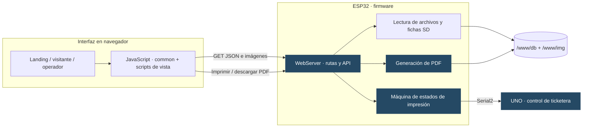
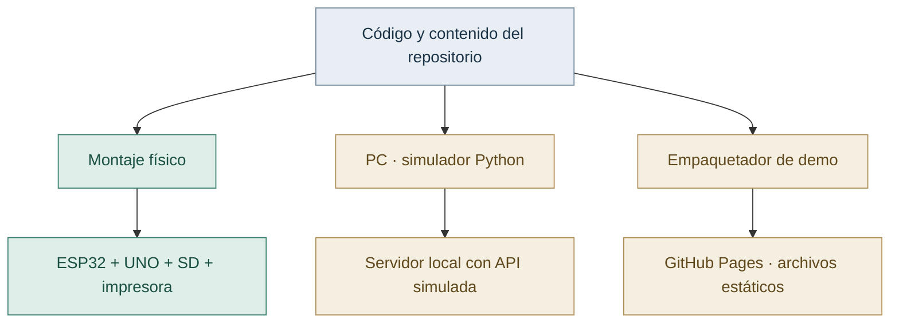

# 01 · Arquitectura de HexaTour, por niveles

El proyecto se organiza en cuatro niveles: contexto, componentes físicos, software y despliegue. Cada diagrama describe el montaje o una de sus modalidades de prueba.

## Nivel 1 · Contexto

No se necesita conexión a Internet para consultar el contenido almacenado localmente. La aplicación de SMS, cuando está configurada, depende del dispositivo del visitante y de su servicio de mensajería; **no la envía el ESP32**.

## Nivel 2 · Contenedores y hardware

El **ESP32-S3** hospeda el portal y los endpoints `/api/print-ruta` y `/api/route-pdf`. La **SD** contiene el HTML, scripts, JSON e imágenes. El **UNO** no sirve páginas: recibe una orden serial y controla la impresora. La pantalla LCD informa estados del dispositivo.

El mapa de conexiones resume los pines declarados por los sketches:

**Cableado:** [plano Draw.io original](diagramas/HexaTourCircuito.drawio) · [SVG](diagramas/HexaTourCircuito.svg) · [pines y alimentación](../firmware/README.md#pines-usados). Verifica alimentación y niveles eléctricos en el montaje antes de energizarlo.

## Nivel 3 · Componentes y responsabilidades de software

La navegación y los botones están definidos en páginas HTML. El archivo [`db/index.json`](../web/www/db/index.json) **no genera por sí solo los botones de categorías**. El navegador obtiene listas y fichas JSON con [`common.js`](../web/www/assets/js/common.js). Los scripts [`visitor-lugar.js`](../web/www/assets/js/visitor-lugar.js) y [`main-lugar.js`](../web/www/assets/js/main-lugar.js) resuelven las acciones de cada perfil.

## Nivel 4 · Tres despliegues distintos

La demo estática se genera desde `web/www` y usa controles explícitos de simulación; **no contiene un servidor Python ni una API de impresión**. El simulador permite probar la web y endpoints en un PC. El montaje real depende de SD, alimentación y placas; publicar una versión en Pages no actualiza su contenido.

## Fronteras de confianza y limitaciones

1. **Panel de operador:** el ESP32 aplica HTTP Basic al servir `/main/`; eso **no equivale** a autorizar todas las operaciones. Los handlers de impresión y PDF no se protegen por el mismo chequeo. Las credenciales se encuentran definidas en el firmware y deben cambiarse antes de una instalación expuesta.
2. **Red local:** el montaje usa HTTP; las contraseñas de ejemplo y la autenticación básica no son suficientes para operar en un entorno no confiable.
3. **Catálogo:** un JSON correcto técnicamente no equivale a indicaciones reales verificadas; hay que revisarlas antes de instalar el punto.
4. **Salida física:** la aceptación HTTP es anterior al protocolo `STATUS?` → `PRINT` → `DONE`. Un timeout después de enviar puede dejar desconocido si se imprimió.
5. **Prueba del montaje:** la [guía de compilación](../firmware/Compilacion.md#montaje-original-y-revalidación) registra las comprobaciones físicas pendientes con la base actual.

La [arquitectura ampliada](Arquitectura.md) documenta endpoints y contrato serial; [flujos y estados](03-flujo-de-usuario.md) muestra las secuencias completas; [formato de datos](Formato-de-datos.md) define las validaciones.
