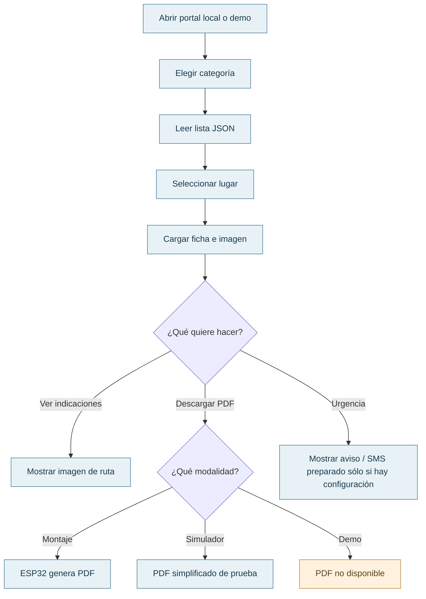
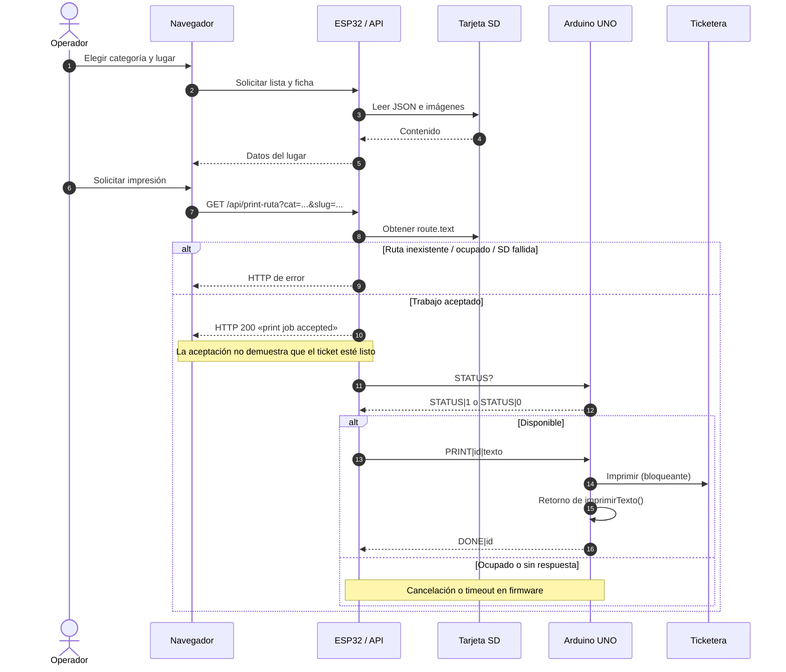
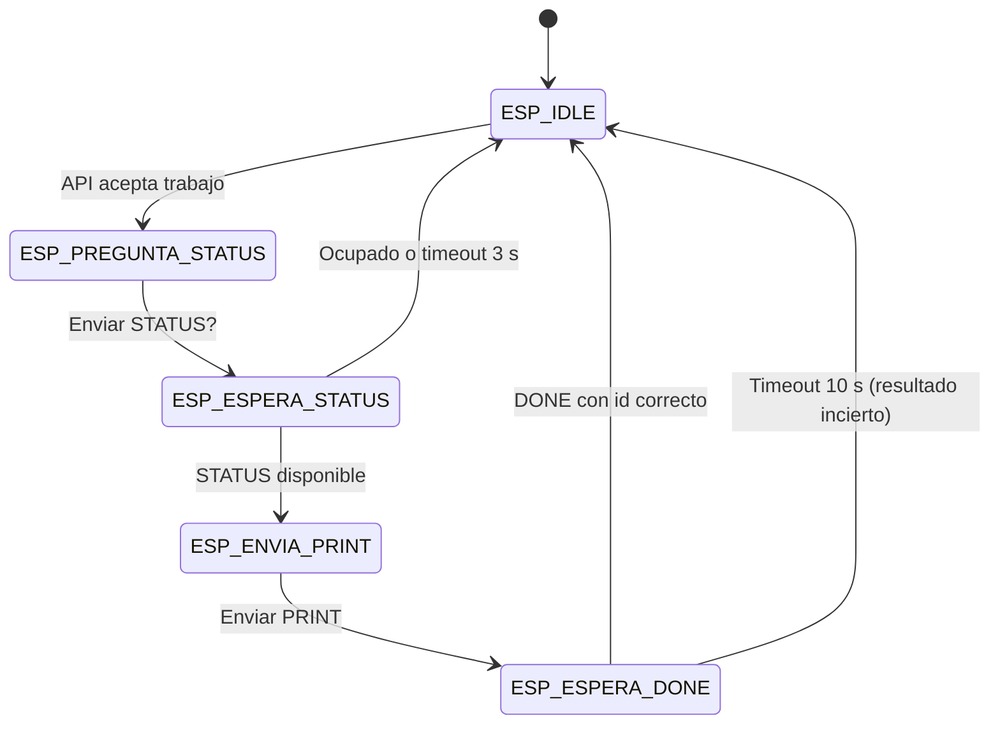
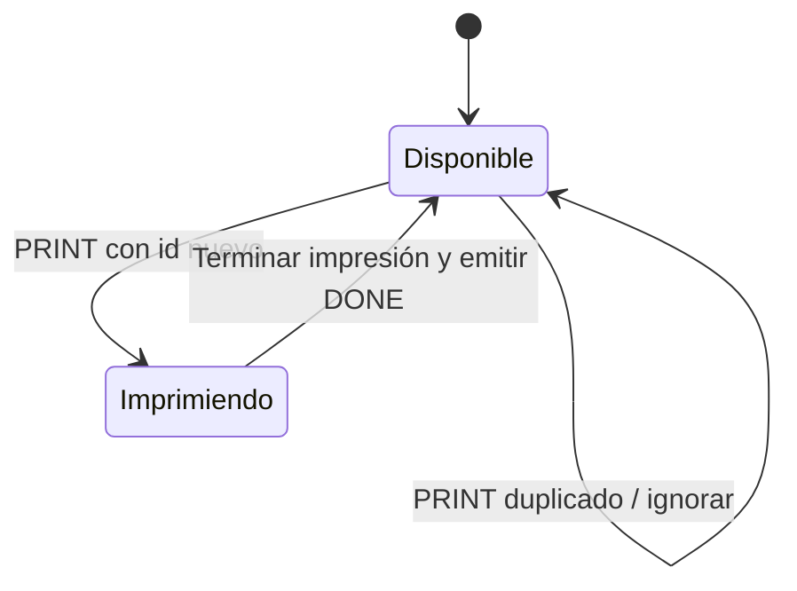

# 03 · Recorridos, secuencias y estados

## Recorrido del visitante

En demo, la opción de urgencia muestra un aviso local. En el montaje puede abrir un SMS preparado si existe configuración; el usuario realiza el envío desde su aplicación. Las rutas mostradas son predefinidas.

## Recorrido del operador e impresión física

El ESP32 envía `STATUS?`, espera hasta **3 s** por respuesta, envía `PRINT` si corresponde y espera hasta **10 s** por `DONE`. El UNO emite `DONE` al terminar su rutina de impresión; no comprueba el papel ni la calidad del ticket. La aplicación no dispone de una consulta web posterior del estado final.

## Máquina de estados del ESP32

Los identificadores son los nombres del `enum Estado` definido en [`HexaTour.ino`](../firmware/esp32/HexaTour/HexaTour.ino). El manejo de mensajes incorrectos y reintentos debe estudiarse en el firmware antes de modificar estos estados.

## Estados del Arduino UNO

El UNO ignora una orden si está ocupado o si su `jobId` coincide con el último aceptado. Mientras se ejecuta `imprimirTexto()`, la lectura de mensajes queda bloqueada.

## Estado de la demo

La demo insertada por el empaquetador identifica su modo con `meta[name="hexatour-mode"]`; en desarrollo también puede activarse mediante `?demo=1`. La impresión muestra una confirmación local de simulación, el PDF se deshabilita y urgencias no contacta con nadie. La navegación conserva el modo de demostración.

[Arquitectura](01-arquitectura-general.md) · [Protocolo serial](../firmware/README.md#protocolo-serial-esp32-uno) · [Comportamiento de la demo](Demo.md)
