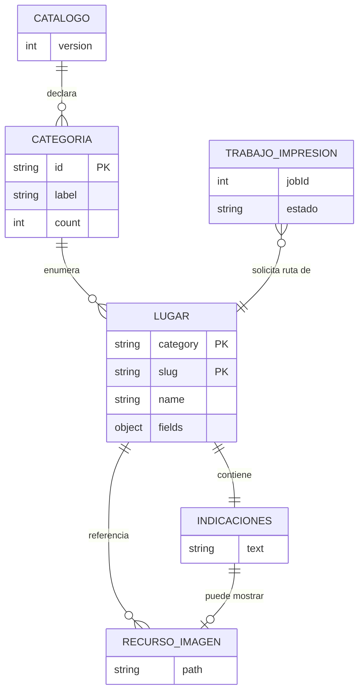
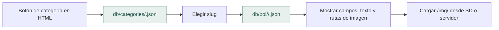

# 04 · Dominio y persistencia en JSON

## Cómo se organiza la información

Las fichas turísticas se guardan como **archivos JSON** dentro de `web/www/db/`; en el montaje, estos archivos se copian a la tarjeta SD bajo `/www/db/`. Las imágenes se guardan como archivos independientes en `/www/img/`.

```text
web/www/
├── db/
│   ├── index.json                     # categorías y conteos declarados
│   ├── categories/campings.json       # lista de lugares por categoría
│   └── poi/campings/camping1.json     # ficha de un lugar
└── img/                               # imágenes y vistas de rutas
```

## Modelo de dominio y cardinalidades



El diagrama representa conceptos y referencias entre archivos. `TRABAJO_IMPRESION` describe el estado en memoria del firmware. Una ficha puede referenciar varias variantes de imagen para distintas resoluciones.

## Estructura de una ficha

Ejemplo abreviado:

```json
{
  "slug": "identificador",
  "name": "Nombre visible",
  "category": "categoria",
  "fields": {
    "descripcion": "Texto informativo",
    "tpie": "Tiempo referencial",
    "tveh": "Tiempo referencial",
    "apertura": "Hora referencial",
    "cierre": "Hora referencial",
    "alertas": "Aviso"
  },
  "route": { "text": "Indicaciones redactadas previamente" },
  "images": {
    "main": "img/categoria/lugar.jpg",
    "route": "img/categoria/rutalugar.jpg"
  }
}
```

El contrato completo, los campos opcionales y las variantes de imagen están en [Formato-de-datos.md](Formato-de-datos.md).

## Flujo de consulta



## Reglas de consistencia

- Las categorías del índice deben tener un JSON correspondiente; los conteos deben coincidir con la cantidad de lugares.
- Cada `slug` debe resolver a su ficha, mantenerse dentro de la carpeta indicada y usar referencias de imagen existentes.
- El navegador tiene categorías codificadas en el HTML; **editar sólo `index.json` no incorpora botones automáticamente**.
- Los JSON se guardan en UTF-8 y se validan antes de copiarlos a SD o empaquetar una nueva demo.
- El catálogo de muestra no está geográficamente verificado; se debe revisar cada nombre, distancia, horario y ruta antes de usarlo con visitantes reales.

**Validación reproducible:** `python -m unittest discover -s test -p 'test_*.py'`. Reglas y excepciones detalladas: [validador y contrato JSON](Formato-de-datos.md) · [actualización de contenido](../web/README.md).
