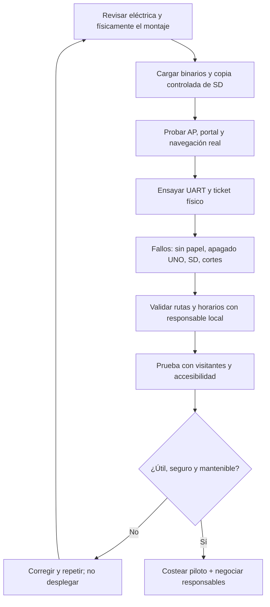

# 20 · Validación física, seguridad y piloto de orientación

[← Índice](README.md) · [Arquitectura](01-arquitectura-general.md) · [Firmware reproducible](../firmware/Compilacion.md) · [Viabilidad](18-analisis-economico-clp-usd.md)

> **Plan de ensayo, no certificado ni bitácora ejecutada.** El montaje académico original se documenta mediante maqueta, circuito y fuentes; los sketches compilaron con el entorno fijado de octubre de 2026, pero la **revalidación física integrada de esos binarios sigue pendiente**.

## 1. Qué se puede verificar ahora y qué falta

| Pieza | Evidencia disponible | Prueba que falta |
| --- | --- | --- |
| **Portal/catálogo** | HTML/JS/JSON, demo estática, simulador Python y pruebas de catálogo | Exactitud de rutas/horarios en un lugar real y accesibilidad en teléfonos |
| **ESP32-S3** | Sketch compilado, AP, DNS, HTTP, SD, PDF y estado de impresión en código | Ensayo de arranque, radio/conexión, SD y PDF en placa con versiones actuales |
| **Arduino UNO** | Sketch compilado y protocolo `STATUS?/PRINT/DONE` | Ensayo de comunicación eléctrica y finalización de impresión real |
| **Ticketera térmica** | Control en firmware y documentación de alimentación separada | Papel, legibilidad, temperatura, consumibles y fallos físicos |
| **LCD I²C** | Controlador y pines documentados | Verificación de estados visibles en montaje |
| **SMS de urgencia** | Opción web de preparación de SMS, normalmente no configurada | Acordar responsabilidad y destinatarios; nunca anunciar asistencia automática |
| **Seguridad de operador** | HTTP Basic para `/main/` | Proteger acciones API y evitar credenciales predeterminadas |
| **Tótem comercial** | Maqueta académica y esquemas | Durabilidad, instalación, accesibilidad, protecciones, autonomía y garantía |

**Lo que no es una prueba:** abrir GitHub Pages, recibir un «print job accepted» HTTP, ver `DONE` simulado, renderizar el circuito o compilar no acredita que se haya entregado un ticket físico ni que un visitante pudo orientarse.

## 2. Diagrama de ensayo y puertas de salida



No usar la aprobación académica como sinónimo de aprobación de seguridad eléctrica o de la información turística.

## 3. Matriz de casos técnicos

| Caso | Procedimiento deseado | Resultado a registrar |
| --- | --- | --- |
| Encendido sin SD | Retirar SD en banco seguro y encender | Error visible, sin navegación engañosa |
| Catálogo inconsistente | JSON incompleto en copia de pruebas | Mensaje, sin imprimir ruta equivocada |
| Sin UNO o UART sin respuesta | Simular interrupción bajo montaje controlado | Timeout, estado de trabajo no completado |
| Impresora sin papel | Ejecutar impresión de prueba | Diferencia entre `DONE` lógico y ticket efectivamente disponible |
| Múltiples pulsaciones | Solicitar impresión repetida | Una política explícita de bloqueo/duplicados |
| Reinicio durante PRINT | Cortar alimentación con protocolo y protecciones | Estado incierto documentado, sin prometer entrega única |
| Portal Android/iOS | Probar al menos variantes y navegadores disponibles, registrar modelos | Red, DNS, apertura manual/cautiva y recursos SD |
| Panel/API sin sesión | Intentar acceso de invitado en banco aislado | Ninguna operación física no autorizada en versión destinada al público |
| Archivos/rutas maliciosas | Probar categorías/slugs inválidos y URLs extrañas | Ninguna lectura fuera de SD ni fallo de disponibilidad |
| PDF grande | Ejecutar con recursos representativos | Memoria, latencia y descarga observadas |

**No hay valores medidos aquí**. La duración de éxito, cobertura de teléfonos y rendimiento de impresión deben registrarse en ensayos controlados antes de publicarse.

## 4. Requisitos antes de uso con público

**Tecnología:** revisar esquemas con responsable competente, aislamiento eléctrico, fuentes de alimentación separadas, niveles UART 3,3 V/5 V, GND común, acceso al papel y riesgos térmicos; elegir estructura adecuada al lugar. Un montaje de interior no debe exponerse al clima sin protecciones pertinentes.

**Seguridad:** cambiar credenciales de ejemplo, proteger `/api/print-ruta` y `/api/route-pdf` según el caso de uso, limitar solicitudes y evitar que parámetros alteren trabajos no autorizados. HTTP Basic del operador sobre HTTP local no basta como garantía general de seguridad en una red pública. La impresión mediante GET es una operación con efectos físicos, por lo que requiere revisión de contrato, autorización y prevención de reintentos involuntarios.

**Contenido:** confirmar lugar, horarios, rutas, alertas, fuente y fecha de revisión con una persona responsable; el contenido actual son ejemplos. No usar el botón de urgencia como si reemplazara servicios de emergencia. Para SMS, se necesita consentimiento, destinatario legítimo, texto de advertencia y participación del usuario.

**Accesibilidad:** alternativas para personas sin teléfono o con dificultades de uso, contraste, tamaño de fuente, idiomas pertinentes y capacidad de orientación física al punto.

## 5. Métricas de piloto útiles y observables

| Pregunta | Indicador y método |
| --- | --- |
| ¿Se orienta el visitante? | % de tareas de búsqueda y comprensión completadas en un guion sin ayuda |
| ¿Realmente sirve sin Internet externo? | % de sesiones en que el usuario finaliza conectándose solo a AP local |
| ¿Imprime lo solicitado? | Tickets físicamente legibles y recogidos / solicitudes aceptadas; distinguir respuestas API |
| ¿La información es correcta? | Fichas verificadas / fichas publicadas, con fuente y fecha |
| ¿Cuánto cuesta una consulta? | Costo total de operación / consultas efectivamente útiles, en período definido |
| ¿Qué exige operar el punto? | Minutos de soporte, reemplazos, incidencias, rollos y energía por período |
| ¿Es rentable? | Precio neto efectivamente cobrado – costo directo completo; contrato y alcance equivalentes |
| ¿Es más útil que una señal? | Comparación A/B en un mismo problema y población de visitantes |

**Sin mediciones, no fijar porcentajes de éxito o ROI.** Registrar sesiones incompletas, papel agotado, rutas incorrectas y desconexiones; no filtrar esos casos para presentar una demostración más favorable.

## 6. Piloto comercial de bajo riesgo

- **Etapa A — laboratorio:** reproducir hardware, resolver problemas de impresión y validación básica.
- **Etapa B — contenido:** seleccionar un conjunto acotado de fichas reales con dueño de información identificable y fecha de revisión.
- **Etapa C — sitio supervisado:** permiso del propietario, energía y soporte, prueba con visitantes voluntarios y alternativa de orientación.
- **Etapa D — costo:** boletas, horas de montaje, papel, mantenimiento y tiempo de revisión del contenido.
- **Etapa E — decisión:** entrevistar responsable que realmente podría comprar/adoptar, registrar precio y condiciones; si una señal física resulta mejor, informar ese resultado.

**Nunca afirmar una instalación permanente, un contrato, un piloto exitoso o asistencia de emergencia sin documento y ensayo que lo respalden.**

## 7. Registro sugerido por sesión

```text
ensayo_id | fecha | commit / firmware ESP32 / UNO | placa y fuente
lugar y condiciones | operador | teléfonos/versión | SD/contenido/fecha
sesiones iniciadas / completadas | solicitudes impresión aceptadas
tickets observados / fallidos | incidentes | costo/horas/mantenimiento
responsable que valida fichas | evidencia (fotos, logs, permisos)
```

**La bitácora aún no existe como resultado experimental**; esta estructura es una recomendación para que futuras afirmaciones se puedan auditar.

[Diagrama de arquitectura](01-arquitectura-general.md) · [Contrato de impresión](03-flujo-de-usuario.md) · [Licencia](../LICENSING.md).
